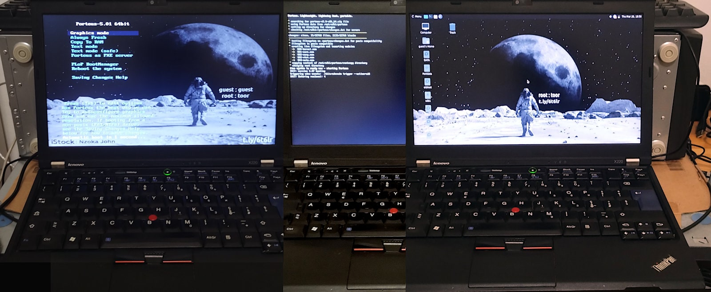
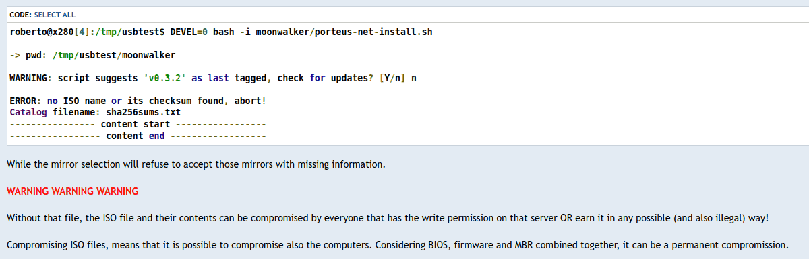

## Light OS - Porteus live USB bootable installer

It creates a bootable USB with 128MB for persistence.

- Porteus root password: **toor**

- Background image source: [Newsweek](https://www.newsweek.com/government-report-new-space-race-nasa-china-1736843)

- Usage: `bash porteus-usb-install.sh /path/file.iso [/dev/]sdx [it] [--ext4-install]`
   - When everything is already local and updated as per the latest ISO.
   - Long option creates a USB bootable installation instead of a LIVE.
   - Performances LIVE vs EXT4 may greatly vary depending on USB stick.
   - First EXT4 installation boot is **slow** because lazy mkfs options.
   - Some USB2 sticks allow legacy boot only, it may be disabled in BIOS.

- Usage: `bash porteus-net-install.sh [<type> <url> <arch> <vers>] [/dev/sdx] [it]`
   - when downloading the ISO and retrieving this repo scripts is needed.

- Usage: `bash porteus-mirror-selection.sh [--clean]`
   - check among the available mirrors the fastest one for downloading.  

The v0.2.0 has been reported that it works also for [PorteuX](https://github.com/porteux/porteux) but I did not test it and I am not granting the compatibility for the future.

---

### Persistence vs Installation

<div align="justify">

> Persistence means that any changes you make to the system (like installing software, saving files, or changing settings) will be saved and available the next time you boot from the USB drive. Without persistence, the system would revert to its original state each time. Installation is a process designed to create a permanent and independent operating environment while a [LIVE](https://en.wikipedia.org/wiki/Live_USB) is running into the computer's RAM, mainly. This allows users to run an OS without modifying the host system's storage. Persistence, is a bridge between the two concepts. &ndash;&nbsp;Gemini&nbsp;2

</div>

To understand the difference between the two variants, the LIVE is the most similar to the original Porteus while the EXT4 allows one to install a system from scratch. The timings of these two examples are referring to Porteus v5.1 (alpha2) an USB 2.0 usbstick 64GB paid €3.11 on Temu:

```
INFO: Creation LIVE usbstick completed in 34 seconds.

Device     Boot   Start     End Sectors  Size Id Type
/dev/sda1  *       2048 2459647 2457600  1.2G  7 HPFS/NTFS/exFAT
/dev/sda2       2459648 3893247 1433600  700M 83 Linux

Filesystem        Size  Used Avail Use% Mounted on
/dev/sda1          16M   13M  3.5M  79% /tmp/usb1
/dev/sda2         1.8G  475M  1.3G  28% /tmp/usb2

INFO: Creation EXT4 usbstick completed in 38 seconds.

Device     Boot   Start     End Sectors  Size Id Type
/dev/sda1  *       2048   34815   32768   16M  7 HPFS/NTFS/exFAT
/dev/sda2         34816 3885055 3850240  1.8G 83 Linux

Filesystem        Size  Used Avail Use% Mounted on
/dev/sda1         1.2G  616M  583M  52% /tmp/usb1
/dev/sda2         672M   28K  623M   1% /tmp/usb2

INFO: boot by EXT4 ubstick, and to proceed with an installation type:

dd if=/dev/sdb bs=1M count=2k of=/dev/sda status=progress oflag=dsync

This will overwrite data on /dev/sda installing a working EXT4 system.
```

In this example the `/dev/sdb` is the usbstick while the `/dev/sda` is the internal storage device which is installed from scratch  (**WARNING**: data loss). For example, writing at 40M/s (USB 2.0) on average, it takes less than a minute for completing the installation.

---

### Preview on 13yo laptop

The ThinkPad X220 was released in April 2011 and was produced until mid-to-late 2012, when it was replaced by the ThinkPad X230. Today, it is a 13yo device and can be bought for around $100 as refurbished or used unit, only. Old but not obsolete.

In fact, it supports SATA2 SSD and 16GB of DDR3 RAM despite its specification indicates 8GB as maximum. While models with the i7-2620M typically include USB 3.0 support, also. However, usually it comes with 4GB of RAM, a 2.5" SATA HDD and USB 2.0, only. 

Porteus 5.01 Mate booting from an old SanDisk Cruzer Fit 32GB USB 2.0 and running on an ultra-old Thinkpad X220 equipped with 4GB of RAM. The storage stick is inserted in the USB 2.0 port, on the bottom left angle, and it is so short that it cannot even be seen without checking for it specifically for it.

<div align="center"></div><br>

How long does it take to prepare such a USB 2.0 stick with a 30MB/s of writing transfer rate? In about 30 seconds (since v0.3.x) with 128MB of persistence. Almost all the time is spent in writing the USB, hence that matters is the writing speed and data size.

#### About other buses/ports

An alternative to using a USB pendrive, is leveraging the internal u/SD reader, if it exists to save a USB port. In this case, it is useful to keep in mind that such embedded readers, like the one included into the Thinkpad **X201**, is limited by the USB version bus bandwidth. In that case the keywords for choosing a u/SD card are: `U3` and `A2` as mandatory, while `v30` and `XCI` as desirable.

So, it does not provide any advantages over the USB bus, and the same **might** apply also to the ExpressCard/54 slot using an adapter working as an USB device and limited to 133 MB/s on those rare units that have the USB 3.0. Instead, using the ExpressCard/54 with a PCIe adapter it can work at 250 MB/s which is near the 300M MB/s available on the internal SATA2.

In conclusion, a USB 2.0 laptop will be limited at 480 Mbps in accessing storage devices unless SATA2 or EC54/PCie is used. And in this particular case, the adoption of a ExpressCard/54 USB 3.0 adapter can provide that upgrade needed to leverage faster USB devices with low power consumption otherwise an extra power source is required.

Instead, the **X220**'s u/SD card reader is on the PCIe bus, so it is faster than USB 2.0 but is not among the bootable devices, unfortunately. However, there are two ways to overcome this issue: 

1. using [Coreboot](https://stoisavljevic.com/articles/coreboot) (aka LinuxBIOS) which is out of the chance of many;

2. boot from an USB device and with the u/SD into the internal reader, and the USB port **can** be freed ASAP the kernel + initrd image are loaded into the RAM, or later.

Noticeably, the USB boot can be replaced by the network boot initiated by the BIOS, or by an internal S/ATA device with a multi-OS bootloader for which Porteus on u/SD can be an alternative to Windows installed into the internal storage device. Just for sake of completeness, some micro-SD to SD form adapters are not working but fortunately `sudo dmesg -w` immediately tells about.

#### Booting from u/SD

The most convenient way to boot from a non-USB u/SD embedded card reader is to install a specific boot option into your grub/windows for a multi-boot system, or create the u/SD as an Moonwalker's Porteous EXT4/INST and the other one as VFAT/LIVE. In that way the usbstick will serve as repair, maintenance and booting device while the other as a main installed Porteus. Alternatively, both devices in EXT4/INST and on the USB the 2nd partition can be formatted or removed (e.g. by gparted), to gain more free space.

---

### Huston, we have a problem

On 25th March 2025, all Porteus mirrors are presenting zeroed sha256sums.txt, and it is quite a thing!



- Source: [A post of mine on forum.porteus.org](https://forum.porteus.org/viewtopic.php?p=102450#p102450)

Without those files the scripts in this project cannot work and making them working is unacceptably insecure.

---

